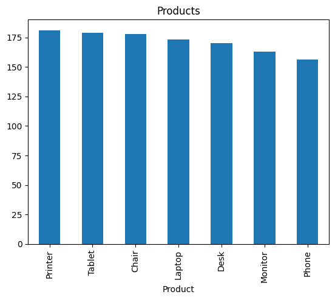
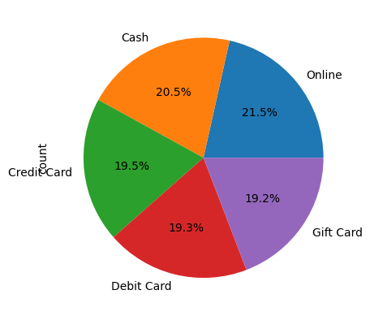
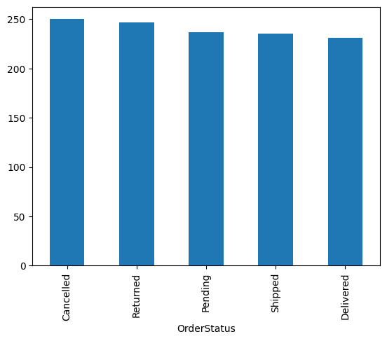

# E-commerce Data Cleaning & Exploratory Data Analysis

## Project Overview

This project was completed as part of my **Data Science Internship at DecodeLabs**.

The objective was to clean an e-commerce dataset, perform exploratory data analysis (EDA), engineer new features, and prepare the dataset for future machine learning applications.

---

## Dataset Information

- **Records:** 1,200 e-commerce orders
- **Features:** 14 columns
- **Data Type:** Transactional sales data

The dataset contains customer orders, products, payment methods, shipping information, coupon usage, and total order prices.

---

## Technologies Used

- Python
- Pandas
- NumPy
- Matplotlib
- Jupyter Notebook

---

## Project Workflow

### 1. Data Exploration
- Loaded the dataset
- Examined data types
- Generated summary statistics
- Inspected categorical and numerical features

### 2. Data Cleaning
- Checked for missing values
- Filled missing values in the `CouponCode` column
- Verified duplicate records
- Detected and handled outliers using the IQR method

### 3. Exploratory Data Analysis (EDA)
- Analyzed product distribution
- Explored payment method distribution
- Investigated order status distribution
- Filtered data using multiple conditions
- Answered business-related questions using Pandas

### 4. Feature Engineering
Created new features including:

- **PricePerItem**
- **UsedCoupon**
- **LargeOrder**

### 5. Export
- Saved the cleaned dataset for future analysis.

---

## Visualizations

### Product Distribution



---

### Payment Method Distribution



---

### Order Status Distribution



---

## Repository Structure

```
ecommerce-data-cleaning-eda/
│
├── Ecommerce_EDA.ipynb
├── data.csv
├── cleaned_data.csv
├── requirements.txt
├── README.md
└── images/
    ├── product_distribution.png
    ├── payment_method_distribution.png
    └── order_status_distribution.png
```

---

## Skills Practiced

- Data Cleaning
- Exploratory Data Analysis (EDA)
- Data Visualization
- Feature Engineering
- Missing Value Handling
- Outlier Detection (IQR Method)
- Data Filtering with Pandas
- Working with Real-World Datasets

---

## Key Takeaways

Through this project, I strengthened my understanding of the complete data analysis workflow, from loading raw data to cleaning, exploring, visualizing, and preparing it for future machine learning tasks.

---

## Author

**Omar**

Data Analyst | Machine Learning Learner

- GitHub: https://github.com/Omar3riish
- LinkedIn: *(Add your LinkedIn profile URL here)*
